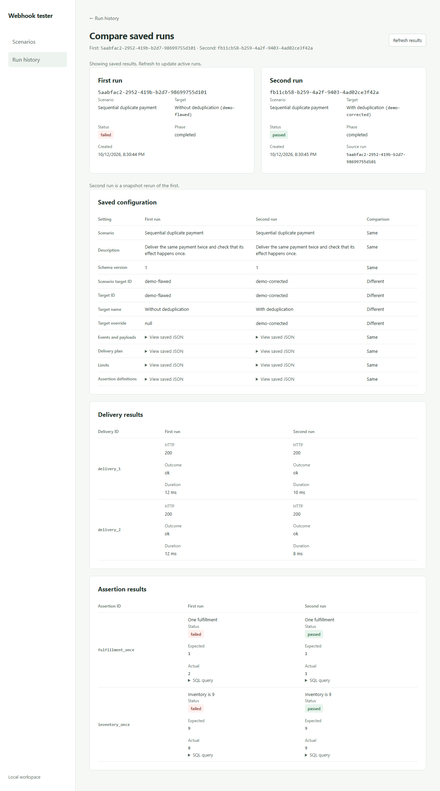

# Webhook tester

A local app for testing duplicate and out-of-order webhooks and inspecting saved results.

## Quick start

Requires Node.js 22.14 or newer, npm, and Docker running Linux containers.
Use Compose 2.24.4 or newer for the isolated browser configuration.
From the repository directory:

```powershell
npm.cmd ci
if (!(Test-Path .env)) { Copy-Item .env.example .env }
docker compose up --build -d --wait
Invoke-RestMethod http://127.0.0.1:4000/health
```

Open http://127.0.0.1:4173. The app runs locally against bundled synchronous
demo handlers. Choose a scenario and a profile; select deliveries to inspect
requests, responses, and timings. Browser closure does not cancel a run.

Web, API, demo target, and PostgreSQL bind to loopback on ports 4173, 4000,
4010, and 55432. Credentials in `.env.example` are disposable. Compose applies
migrations before dependent services start. Existing volumes retain data and
passwords; stop services with `docker compose down` without deleting the volume.

## Demo

Run **Sequential duplicate payment** with **Without deduplication**. Both requests
return HTTP 200, but assertions fail: fulfillment 2, inventory 8. Choose
**With deduplication** under **Rerun with**: the saved snapshot passes at 1/9.
Select both results in Run history and Compare runs. Refresh either view to
read the same saved evidence.



## Project status

**Working now**

- Four payment/status presets, sequential and bounded concurrent delivery,
  transactional deduplication, and guarded status versions.
- Scenario creation, revision-checked editing, duplication, and strict JSON
  import/export. Conflicts preserve unsaved drafts; seeds preserve saved edits.
- Frozen enqueue snapshots, SQL scalar assertions, request/response details,
  saved progress replay, and interruption without automatic resend.
- Bounded history, snapshot reruns, and comparisons aligned by configuration ID.
- Isolated startup and local unit, PostgreSQL, and Chromium browser checks.

**Next up**

- Custom local targets and signature cases.

## Development

Stop the Compose worker before host integration tests so tests own their worker.
The marked test database uses port 55433 and temporary storage.

```powershell
docker compose stop worker
docker compose -p webhook-tester-tests -f compose.test.yaml up -d --wait
npm.cmd run ci:local
docker compose -p webhook-tester-tests -f compose.test.yaml down
docker compose start worker
```

`ci:local` runs lint, formatting, types, unit/integration tests, and builds.
Individual scripts include `test:unit`, `test:integration`, `test`, and `migrate`.
Native service commands are `dev:api`, `dev:demo`, `dev:worker`, and `dev:web`;
load `.env` and run `migrate` first.

Browser tests require the full isolated stack and use one Playwright worker:

```powershell
npx.cmd playwright install chromium
docker compose -p webhook-tester-e2e -f compose.yaml -f compose.e2e.yaml up --build -d --wait
npm.cmd run test:e2e
docker compose -p webhook-tester-e2e -f compose.yaml -f compose.e2e.yaml down --volumes
```

`npm.cmd` avoids PowerShell restrictions on `npm.ps1`. CI verifies the same flow
on Linux; it does not publish. See [architecture](docs/architecture.md).

Relevant modules/configuration were adapted from `suryaB-eng/webhook-lab` at
`e6a761182bd338f68dd439e260bb25b3d91bb44c`; its history was not imported.
The MIT notice remains in [LICENSE](LICENSE).
